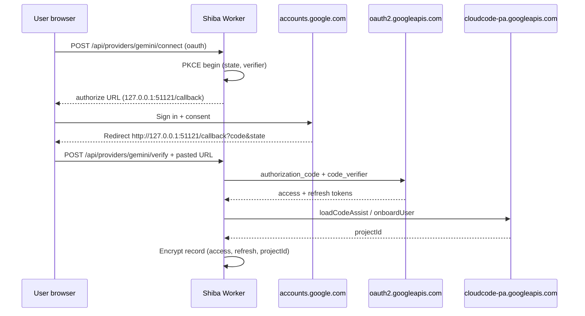
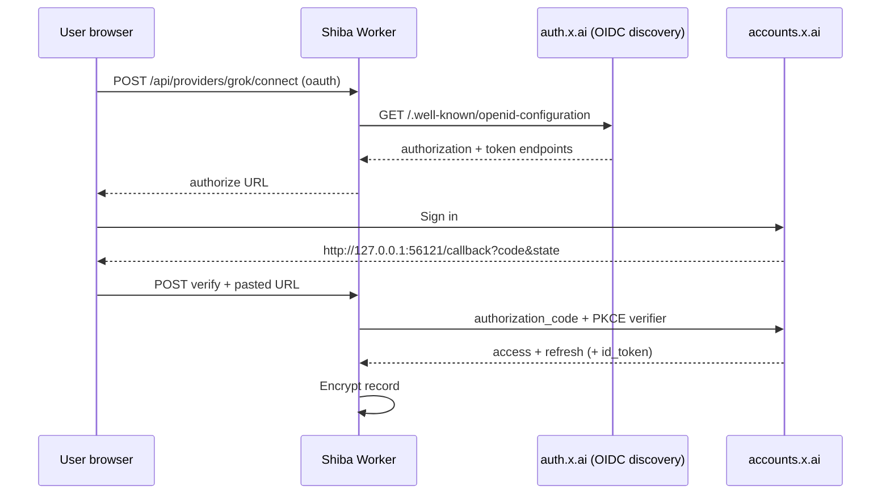
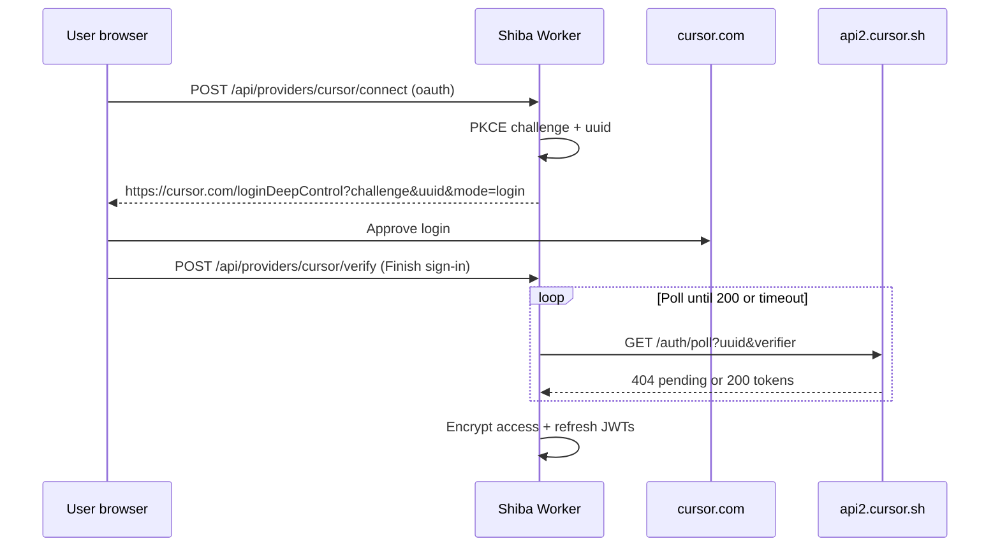

# Provider login flows (opencodex reference)

Reverse-engineered from [opencodex](https://github.com/lidge-jun/opencodex) (`src/oauth/*`) and implemented on the Shiba Providers card with the same per-user encryption + egress injection model as ChatGPT device grant (PR #155) and Claude setup-token (PR #147).

## Shared Shiba contract

| Step | Behavior |
|------|----------|
| Sign-in UI | `/api/providers/:id/connect` with `mode: "oauth"` |
| Pending state | `UserProviderOAuth` Durable Object (per user), 15-minute TTL |
| Tokens at rest | AES-GCM in D1 `user_subscription_credentials` via `MODEL_CREDENTIAL_KEY` |
| Runtime | Sandbox sees `shiba-egress-placeholder` / dummy keys; Worker `forward*` handlers attach real bearer tokens |
| Refresh | `UserProviderOAuth` `/access` refreshes when `expiresAt` is near |

---

## Gemini — Google Antigravity (Cloud Code Assist)

**opencodex:** `src/oauth/google-antigravity.ts`  
**Shiba harness:** `antigravity-subscription` (`agy` ACP) for OAuth; `gemini-acp` when the card uses API key.

### Sequence

| Item | Value |
|------|--------|
| Client ID | `1071006060591-tmhssin2h21lcre235vtolojh4g403ep.apps.googleusercontent.com` (public Antigravity desktop client; override `GOOGLE_ANTIGRAVITY_CLIENT_ID`) |
| Client secret | Public desktop secret in opencodex; override `GOOGLE_ANTIGRAVITY_CLIENT_SECRET` |
| Auth | `https://accounts.google.com/o/oauth2/v2/auth` |
| Token | `https://oauth2.googleapis.com/token` |
| Redirect | `http://127.0.0.1:51121/callback` (`pnpm dev` / `pnpm shiba dev` start a local listener; paste only if that listener is off) |
| PKCE | S256 |
| Scopes | `cloud-platform`, `userinfo.email`, `userinfo.profile`, `cclog`, `experimentsandconfigs` |
| Post-login | `loadCodeAssist` → `onboardUser` if needed; **projectId required** |
| Egress hosts | `cloudcode-pa.googleapis.com`, `daily-cloudcode-pa.googleapis.com`, `generativelanguage.googleapis.com` |
| Handler | `antigravityUser` + `userId` |

---

## Grok — xAI OAuth

**opencodex:** `src/oauth/xai.ts`

### Sequence

| Item | Value |
|------|--------|
| Discovery | `https://auth.x.ai/.well-known/openid-configuration` |
| Client ID | `b1a00492-073a-47ea-816f-4c329264a828` |
| Redirect | `http://127.0.0.1:56121/callback` (auto via `pnpm dev` loopback listener) |
| Scope | `openid profile email offline_access grok-cli:access api:access` |
| Refresh | `grant_type=refresh_token` to discovered token endpoint |
| Egress | `api.x.ai` via `xaiUser` |
| Fallback | API key paste → existing `forwardGoogle` / gateway BYOK path on `grok` harness |

---

## Cursor — PKCE poll (cursor-agent CLI)

**opencodex:** `src/oauth/cursor.ts` (jawcode port)

### Sequence

| Item | Value |
|------|--------|
| Login | `https://cursor.com/loginDeepControl` |
| Poll | `https://api2.cursor.sh/auth/poll` |
| Refresh | `POST https://api2.cursor.sh/auth/exchange_user_api_key` with refresh bearer |
| Egress | `api2.cursor.sh`, `repo2.cursor.sh` via `cursorUser` |
| Harness | `cursor-subscription` — `cursor-agent --force acp` |
| Operator fallback | `CURSOR_SUBSCRIPTION_TOKEN` wrangler secret + `SHIBA_CURSOR_SUBSCRIPTION=1` |

---

## Codex / Claude (existing)

| Provider | Flow | Reference |
|----------|------|-----------|
| Codex | Device grant + optional loopback SIWC | `ChatGptAuth` DO, PR #155 |
| Claude | Daemon pairing or `claude setup-token` | PR #147 |

---

## Server-side limitations

- **Loopback redirects:** Antigravity and xAI expect `http://127.0.0.1` callbacks. The Worker cannot receive those redirects; the operator must paste the full URL from the browser (same as ChatGPT PKCE fallback).
- **Cursor poll:** Requires outbound access from the Worker to `api2.cursor.sh` (works server-side).
- **Antigravity project discovery:** Requires Worker egress to `cloudcode-pa.googleapis.com` / `daily-cloudcode-pa.googleapis.com` during sign-in.

---

## opencodex token storage (contrast)

opencodex stores OAuth credentials locally (`src/oauth/store.ts`) on the operator machine. Shiba never writes tokens into the sandbox filesystem for these Providers flows; only encrypted D1 + egress injection.
